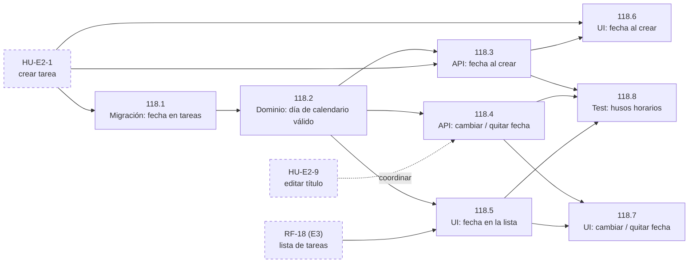

# Tickets de FS-118 · Fecha de vencimiento de una tarea

Historia: [us-fechas-vencimiento.md](us-fechas-vencimiento.md). Cada ticket cumple los criterios de la historia que indica. La checklist de entrega por tipo está en [definition-of-done.md](../definition-of-done.md); aquí solo se anota lo propio de cada ticket.

## Antes de empezar

- **Historias previas sin ID todavía.** Hoy el repo solo tiene usuarios y tokens, y FS-118 necesita tres historias que aún no tienen ID:
  - crear tarea (HU-E2-1);
  - editar tarea (HU-E2-9);
  - la lista (RF-18, de E3).
- **CA-9 y CA-11 no tienen ticket.** Definen cuándo una tarea está "vencida", pero CA-10 dice que nada en el MVP lo muestra. Se quedan como definición hasta que alguna funcionalidad las use.
- **No hay tickets de tipo Bug.** Esta historia no tiene ningún fallo abierto.

## Tickets

### FS-118.1 · Añadir la fecha de vencimiento a las tareas
- **Tipo:** Migración/DB. **Capa:** migración.
- **Criterios:** base para CA-1 a CA-5.
- **Qué se exige además:** una tarea sin fecha sigue siendo válida (CA-2 y CA-5).
- **Bloqueado por:** HU-E2-1 (crear tarea).
- **Talla S, riesgo bajo.** Es un dato opcional nuevo y no hay datos antiguos que migrar. El riesgo está en que la generación del esquema convierta un "día" en fecha con hora y zona, así que hay que revisar el diff de `database/schema.ts`.

### FS-118.2 · La fecha es un día de calendario válido
- **Tipo:** Modelo/Dominio. **Capa:** validador y transformer.
- **Criterios:** CA-6, CA-8 y CA-12.
- **Qué se exige además:**
  - Tests unitarios para cuatro casos: fecha pasada (se acepta), fecha imposible (se rechaza con un mensaje), sin fecha (se acepta) y quitar la fecha.
  - La fecha sale del backend como un día, sin hora ni zona.
- **Bloqueado por:** FS-118.1.
- **Talla M, riesgo alto.** Aquí van los primeros tests unitarios del repo. Además, aquí se decide que la fecha es un día y no un instante, que es donde es más fácil desplazarla un día sin darse cuenta. VineJS 4 va por delante de la documentación conocida: hay que comprobar sus `.d.ts`.

### FS-118.3 · Aceptar la fecha al crear una tarea
- **Tipo:** Endpoint/API. **Capa:** endpoint de creación.
- **Criterios:** CA-1, CA-2, CA-6, CA-12 y CA-14.
- **Qué se exige además:** un test functional por cada criterio. Si el título no es válido, la tarea no se crea aunque la fecha sí lo sea.
- **Bloqueado por:** FS-118.2 y el endpoint de crear tarea (HU-E2-1).
- **Talla M, riesgo medio.** El cambio es pequeño, pero aquí van los primeros tests functional, con la BD aislada. Si HU-E2-1 deja las suites ya montadas, baja a S.

### FS-118.4 · Cambiar, poner y quitar la fecha de una tarea existente
- **Tipo:** Endpoint/API. **Capa:** endpoint de edición.
- **Criterios:** CA-3, CA-4, CA-5, CA-7, CA-12 y CA-16.
- **Qué se exige además:**
  - Un test en el que alguien que no es el responsable de la tarea cambia la fecha (CA-7).
  - Un test que comprueba que quitar la fecha no toca el título, el responsable ni el estado (CA-5).
- **Bloqueado por:** FS-118.2. Hay que coordinarlo con HU-E2-9 (editar título) para no tener dos endpoints de edición.
- **Talla M, riesgo medio-alto.** Probablemente es el primer endpoint de edición del proyecto. El error típico es confundir "quitar la fecha" con "no tocar la fecha".

### FS-118.5 · Mostrar la fecha en la lista
- **Tipo:** Frontend. **Capa:** UI de la lista.
- **Criterios:** CA-8, CA-10, CA-15 y CA-17.
- **Qué se exige además:** la fecha aparece en formato español y sin conversión de zona. Una tarea vencida no lleva ningún color, icono ni etiqueta.
- **Bloqueado por:** FS-118.2 y la lista (RF-18, de E3).
- **Talla S, riesgo alto.** El riesgo es mayor de lo que su tamaño sugiere. Si en el navegador se convierte un día suelto en una fecha, se toma como medianoche UTC, y en cualquier zona con UTC negativo se ve el día anterior. En España no se nota.

### FS-118.6 · Poner la fecha al crear una tarea
- **Tipo:** Frontend. **Capa:** UI de creación.
- **Criterios:** CA-1, CA-2, CA-6, CA-12 y CA-14.
- **Qué se exige además:** crear sin tocar la fecha no añade ningún paso. El error de la fecha y el del título se muestran cada uno junto a su campo.
- **Bloqueado por:** FS-118.3 y la UI de crear tarea (HU-E2-1).
- **Talla M, riesgo medio-bajo.** Los componentes shadcn instalados no incluyen un selector de fecha. Si se usa el selector nativo del navegador, su formato cambia según el navegador y el idioma, y puede chocar con CA-17.

### FS-118.7 · Cambiar o quitar la fecha desde la lista
- **Tipo:** Frontend. **Capa:** UI de edición.
- **Criterios:** CA-3, CA-4, CA-5, CA-7, CA-12 y CA-13.
- **Qué se exige además:** al cancelar, la tarea queda como estaba. Si la fecha nueva se rechaza, se sigue viendo la anterior.
- **Bloqueado por:** FS-118.4 y FS-118.5.
- **Talla M, riesgo medio-alto.** No está definido cómo se edita desde la lista. Quien lo implemente tiene que decidir cómo se interactúa, y esa decisión afecta a HU-E2-9 y a la edición del estado.

### FS-118.8 · Pruebas de la fecha en husos horarios distintos
- **Tipo:** Test. **Capa:** API y UI.
- **Criterios:** CA-8.
- **Qué se exige además:**
  - En la API se comprueba que una fecha guardada se devuelve igual, sea cual sea la zona del cliente y la del servidor.
  - En la UI se comprueba a mano con el navegador en al menos tres zonas, una de ellas con UTC negativo, y se anota en el PR.
- **Bloqueado por:** FS-118.3, FS-118.4 y FS-118.5.
- **Talla M, riesgo medio.** El riesgo está en lo que pueda destapar: si falla, lo más probable es que haya que reabrir FS-118.2 o FS-118.5.

## Grafo de dependencias

Las flechas van de lo que bloquea a lo bloqueado. Las cajas con borde discontinuo son historias que aún no tienen ticket.

La línea punteada entre HU-E2-9 y FS-118.4 no es un bloqueo: indica que hay que coordinarse para no crear dos endpoints de edición.

## Orden de implementación

**Requisito previo:** HU-E2-1 (crear tarea) y RF-18 (la lista) tienen que estar hechas.

**Corte 1: crear una tarea con fecha y verla en la lista.** Cubre CA-1, CA-2, CA-6, CA-8, CA-10, CA-12, CA-14 y CA-17.

1. FS-118.1 Migración.
2. FS-118.2 Dominio.
3. FS-118.3 API de creación.
4. FS-118.5 Fecha en la lista. Va antes que FS-118.6 porque CA-1 exige que la fecha aparezca en la lista.
5. FS-118.6 Fecha en la creación.

**Corte 2: cambiar y quitar la fecha.** Cubre CA-3, CA-4, CA-5, CA-7, CA-13, CA-15 y CA-16.

6. FS-118.4 API de edición, coordinada con HU-E2-9.
7. FS-118.7 UI de edición.

**Cierre**

8. FS-118.8 Pruebas de husos horarios. No es opcional: CA-8 es el fallo que más fácil pasa desapercibido.

**Si hay dos personas:** cuando FS-118.2 está terminado, FS-118.3, FS-118.4 y FS-118.5 se pueden hacer a la vez.
- Una persona de backend: FS-118.3 → FS-118.4 → FS-118.8.
- Una persona de frontend: FS-118.5 → FS-118.6 → FS-118.7.

El camino más largo es de cinco tickets: FS-118.1 → FS-118.2 → FS-118.3 o FS-118.4 → FS-118.5 → FS-118.8.

## Tallas y riesgo

Hay dos tickets de talla S, seis de talla M y ninguno L. Las tallas no son horas: se basan en el estado actual del repo, que todavía no tiene ninguna suite de tests, y en lo que exige cada ticket. Los tres tickets con más riesgo (FS-118.2, FS-118.5 y FS-118.8) dependen de la misma decisión: que la fecha es un día y no un instante. Conviene que los revise la misma persona.

| Ticket | Talla | Riesgo |
|---|---|---|
| FS-118.1 | S | Bajo |
| FS-118.2 | M | Alto |
| FS-118.3 | M | Medio |
| FS-118.4 | M | Medio-alto |
| FS-118.5 | S | Alto |
| FS-118.6 | M | Medio-bajo |
| FS-118.7 | M | Medio-alto |
| FS-118.8 | M | Medio |
