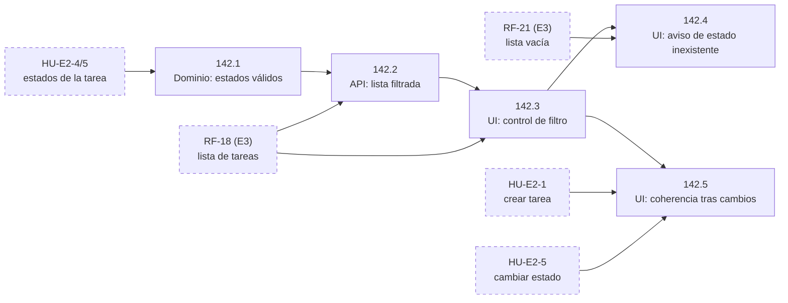

# Tickets de FS-142 · Filtrar la lista por estado

Historia: [us-filtrar-por-estado.md](us-filtrar-por-estado.md).

Cada ticket cumple los criterios de la historia que indica. La checklist de entrega de cada tipo de ticket está en [definition-of-done.md](../definition-of-done.md); aquí solo se anota lo propio de cada uno.

## Antes de empezar

- **No hay ticket de Migración/DB.** Filtrar por un estado que ya existe no cambia lo que se guarda.
- **No hay ticket de Test aparte.** Las pruebas van en la checklist de cada ticket, porque ningún criterio afecta a varias capas a la vez, como sí pasaba con CA-8 en FS-118.
- **El filtro forma parte de la dirección de la página.** Por eso un enlace abre la lista ya filtrada (CA-6) y al recargar se mantiene el filtro (CA-14).

## Tickets

### FS-142.1 · Los estados válidos se definen en un solo sitio
- **Tipo:** Modelo/Dominio. **Capa:** dominio y validador.
- **Criterios:** CA-1 y CA-6.
- **Qué se exige además:**
  - Pendiente, En curso y Hecha se definen en un único punto, que usan tanto la tarea como el filtro.
  - Tests unitarios para tres casos: cada estado válido se acepta; no indicar estado se acepta y equivale a "Todas"; un estado que no existe se rechaza con un mensaje que nombra los válidos.
- **Bloqueado por:** la historia que da estado a las tareas (HU-E2-4 y HU-E2-5, todavía sin ID).

### FS-142.2 · La lista de tareas se puede pedir filtrada por estado
- **Tipo:** Endpoint/API. **Capa:** endpoint de listado.
- **Criterios:** CA-2, CA-3, CA-4, CA-5, CA-6, CA-8, CA-9, CA-10 y CA-13.
- **Qué se exige además:**
  - Un test functional por criterio.
  - Un estado que no existe da un error explícito, nunca una lista vacía (CA-6). Un estado válido sin tareas da una lista vacía sin error (CA-8). El test distingue los dos casos.
  - Un test en el que un usuario filtra y otro pide la lista y la recibe completa (CA-10).
  - Un test que comprueba que filtrar no modifica ninguna tarea (CA-9).
- **Bloqueado por:** FS-142.1 y el endpoint de la lista (RF-18, de E3).

### FS-142.3 · Control de filtro en la lista
- **Tipo:** Frontend. **Capa:** UI de la lista.
- **Criterios:** CA-1, CA-2, CA-3, CA-4, CA-10 y CA-14.
- **Qué se exige además:** hay exactamente cuatro opciones y, al entrar, "Todas" está seleccionada. El filtro queda en la dirección de la página, de modo que un enlace abre la lista filtrada y al recargar se mantiene.
- **Bloqueado por:** FS-142.2 y la UI de la lista (RF-18, de E3).

### FS-142.4 · Aviso de estado inexistente, distinto del de lista vacía
- **Tipo:** Frontend. **Capa:** UI de la lista.
- **Criterios:** CA-6, CA-7 y CA-8.
- **Qué se exige además:**
  - Un enlace con un estado que no existe muestra el aviso junto con los estados válidos.
  - Al elegir cualquier opción del filtro, el aviso desaparece.
  - Un filtro sin resultados muestra el estado vacío con la opción de crear una tarea, y no se confunde con el aviso.
- **Bloqueado por:** FS-142.3 y el estado vacío de la lista (RF-21, de E3).

### FS-142.5 · La vista filtrada se mantiene coherente tras mis cambios
- **Tipo:** Frontend. **Capa:** UI de la lista.
- **Criterios:** CA-11 y CA-12.
- **Qué se exige además:**
  - Si una tarea pasa a un estado que no coincide con el filtro, sale de la vista y el cambio queda guardado.
  - Si se crea una tarea fuera del filtro activo, se confirma que se ha creado aunque no aparezca en la vista.
- **Bloqueado por:** FS-142.3, la UI de cambiar el estado (HU-E2-5) y la UI de crear una tarea (HU-E2-1).

## Grafo de dependencias

Las flechas van de lo que bloquea a lo bloqueado. Las cajas discontinuas son historias que todavía no tienen ticket.

## Orden de implementación

1. FS-142.1 Estados válidos.
2. FS-142.2 Lista filtrada en la API.
3. FS-142.3 Control de filtro.
4. FS-142.4 y FS-142.5 se pueden hacer en paralelo, cada uno cuando tenga resueltas sus dependencias externas.
