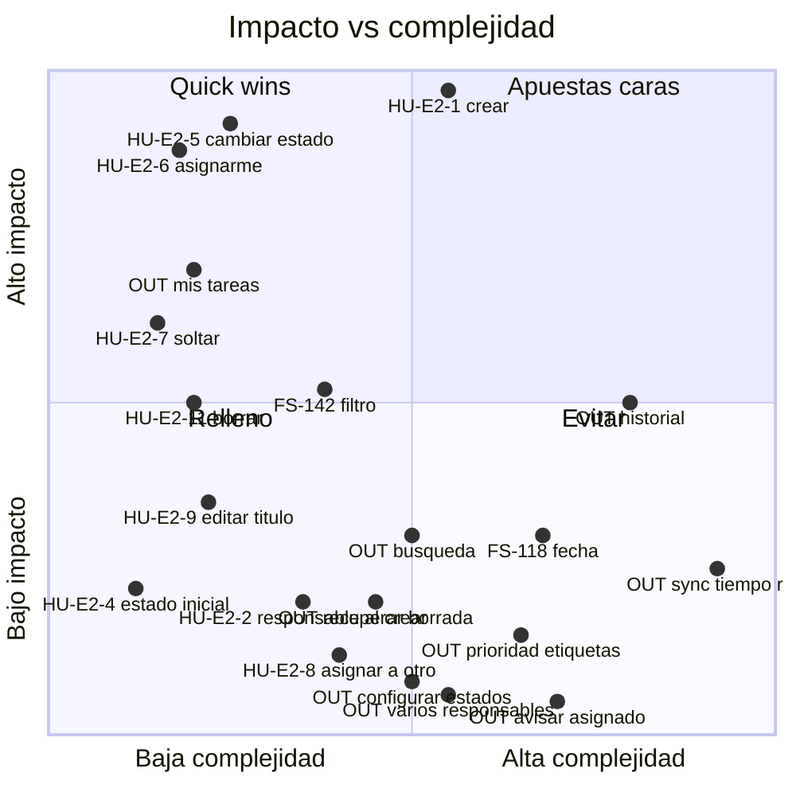

# Priorización de E2 «Gestión de tareas»

Esta matriz cruza impacto y complejidad para las historias de E2, incluidas las que quedaron fuera del MVP, y para el sync en tiempo real de E3.

- **Impacto:** cuánto ayuda la historia a validar la hipótesis central, que es que la gente escribe su estado y que eso deja ver quién está en qué y qué está libre.
- **Complejidad:** cuánto cuesta construirla partiendo del repo actual, donde las tareas todavía no existen.
- **Quick win (⭐):** alto impacto y baja complejidad.

El sync en tiempo real de E3 y las historias marcadas como *OUT* están **fuera del alcance del MVP** según el PRD. Salen en la matriz como referencia, pero no entran en el backlog.

## Matriz

## Clasificación y motivo

| Historia | Impacto | Complejidad | Motivo |
|---|---|---|---|
| **HU-E2-5 cambiar estado** ⭐ | Alto | Baja | Es la acción central de JTBD-3: si no se hace en dos clics, la hipótesis cae. Una vez existe la tarea, solo hay que cambiar un dato. |
| **HU-E2-6 asignarme** ⭐ | Alto | Baja | Es la señal de "ya la he cogido" y evita que dos personas hagan lo mismo (JTBD-1 y JTBD-2). No hace falta elegir entre personas. |
| HU-E2-1 crear | Alto | Media | Sin ella no hay nada. Su complejidad es media porque es la primera entidad y trae las primeras suites de test. |
| HU-E2-7 soltar | Medio | Baja | Una tarea abandonada vuelve a aparecer como libre, así que la lista no miente. Es la acción inversa de asignarme. |
| HU-E2-11 borrar | Medio | Baja | Sin ella se acumula basura y la lista deja de ser fiable. El riesgo es de producto (PA-4), no técnico. |
| FS-142 filtro | Medio | Baja-media | Con como mucho 10 personas, la lista tarda en crecer; el problema aparece cuando se acumulan las Hechas (PA-7). Sin migración. |
| HU-E2-9 editar título | Bajo-medio | Baja | Sirve para corregir erratas. Comparte endpoint de edición con FS-118.4. |
| FS-118 fecha | Bajo-medio | Media-alta | Responde a "para cuándo", no a "quién está en qué". Son 8 tickets y tres tienen riesgo alto por los husos horarios. **Está dentro del alcance por decisión de producto**; la matriz solo decide su posición. |
| HU-E2-4 estado inicial | Bajo | Baja | Se puede crear la tarea y cambiarle el estado justo después. |
| HU-E2-2 responsable al crear | Bajo | Baja-media | Asignarme ya lo cubre. Asignar a otra persona obliga a elegir entre personas (RF-5) y choca con PA-5. |
| HU-E2-8 asignar a otro | Bajo o negativo | Media | Choca con la premisa de que el estado lo escribe quien hace la tarea (PA-5). |
| *OUT* mis tareas (filtrar por responsable) | Medio-alto | Baja | Es un quick win fuera de alcance. La propuesta de valor dice que la lista es "la cola de trabajo de cada persona", pero no hay forma de ver solo la tuya. |
| *OUT* sync en tiempo real (E3) | Bajo | Alta | La decisión se toma al abrir la lista, y el solapamiento que se quiere evitar dura días, no segundos. Necesita infraestructura que hoy no existe, gestionar reconexiones y probar con varios clientes. |
| *OUT* historial | Medio | Alta | Es lo que pediría JTBD-4 si hubiera que ver "qué se ha movido" (PA-6). Abre otra pregunta y exige guardar los cambios. |
| *OUT* búsqueda | Bajo-medio | Media | Solo tiene sentido si la lista crece mucho, y con 3 a 10 personas no pasa. |
| *OUT* recuperar tarea borrada | Bajo | Media | Solo importa si borrar resulta peligroso de verdad, y eso depende de PA-4. |
| *OUT* prioridad, etiquetas, subtareas | Bajo | Media-alta | Es el "rollo de Jira" que el producto evita: más decisiones al crear una tarea. |
| *OUT* configurar estados | Negativo | Media | Contradice la premisa de "sin flujos de configuración". |
| *OUT* varios responsables | Negativo | Media | Diluye quién lleva cada tarea. |
| *OUT* avisar al asignado | Negativo | Media-alta | Es una interrupción, justo lo que el producto quiere quitar, y además necesita infraestructura de envío. |

## Orden de backlog priorizado (solo MVP)

**Primer corte: crear, coger y mover.** Es lo mínimo para ver si la gente usa la lista.

1. **HU-E2-1 crear.** En paralelo hay que hacer la lista de E3 (RF-18), porque todo lo demás la necesita.
2. **HU-E2-6 asignarme** ⭐
3. **HU-E2-5 cambiar estado** ⭐

**Segundo corte: mantener la lista honesta.**

4. **HU-E2-7 soltar**
5. **HU-E2-11 borrar.** Antes hay que decidir PA-4.

**Tercer corte: vista y datos de la tarea.**

6. **FS-142 filtro.** Va antes que la fecha porque aporta más, cuesta menos y no necesita migración.
7. **HU-E2-9 editar título.** Crea el endpoint de edición, que luego reutiliza FS-118.4.
8. **FS-118 fecha.** Es la historia más cara y con más riesgo, y se apoya en la edición ya hecha.

**Al final: comodidad y lo que depende de decisiones pendientes.**

9. **HU-E2-4 estado inicial**
10. **HU-E2-2 responsable al crear**
11. **HU-E2-8 asignar a otro.** Solo entra si PA-5 se resuelve a favor; si no, sale del backlog.
